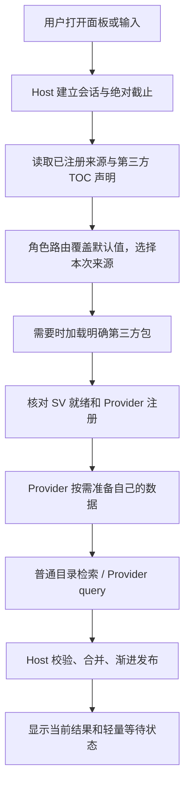

# Lychee 架构与职责

## 文档职责

本文件负责模块职责、依赖方向、运行链路、数据所有权、技术边界与生命周期。产品定位、功能范围和业务取舍见 [PRODUCT.md](PRODUCT.md)；界面信息层级、布局、视觉和交互反馈见 [DESIGN.md](DESIGN.md)。性能预算只在 [PERFORMANCE.md](PERFORMANCE.md) 维护，公开接口的完整字段与契约只在 [SDK](lychee-sdk/README.md) 维护。

SDK 1.0.0 / Provider API 1.0.0。本页描述当前运行结构及其与公开接口的关系。迁移背景保留在[单插件功能迁移](docs/archive/design/2026-09-14-single-addon-feature-port.md)，实际验证范围见[验收记录](docs/archive/validation/README.md)；历史方案不覆盖现行契约。

## 物理包与逻辑模块

发行运行包只有 `addon/Lychee`。自带功能在 `Providers/<功能>`，与 Host 同包加载；它们仍有清晰的数据、词表、事件和动作所有者。目录拆分不代表原生按需加载，也不能在窗口关闭时卸载已经加载的 Lua/SV。

第三方是独立 AddOn，拥有代码、TOC、存档、媒体与许可证。接入只通过 `_G.Lychee` 和可嵌入 SDK；禁止依赖 LycheeInternal、ProviderModules 或 Host 私有素材。自带业务可以复用项目内部装配，但不能让第三方复制装配才能接入。Host 不硬编码第三方名称。

## 各方负责什么

| 角色 | 负责 | 不负责 |
| --- | --- | --- |
| Host | 发现声明、路由、加载协调、当前查询、统一排序展示、动作调度、有界偏好与引用 | 解释第三方业务数据、代管全部业务 DB、猜测 Provider 的缓存失效。 |
| Provider | 事实读取、语言与别名、查询/恢复、动作声明、准备、业务缓存和后台通信 | 控制 Host 根窗口、替 Host 决定其他来源加载、把搜索取消当业务停用。 |
| 独立第三方 AddOn | 原生依赖、客户端文件、SV 时序、媒体、自身启动 | 修改 Host 源码才能被发现，借用兄弟包私有目录。 |
| Action | 一个明确行为、参数 schema、资格检查、执行与结果 | 决定通用搜索生命周期。 |
| Invocation | 某目标 + 某动作/版本 + 规范参数的具体调用 | 以标题或行号代替身份，在预览时执行。 |
| Widget / View | 显示状态、收集输入、绑定当前动作；关闭解除 UI 资源 | 决定插件加载、业务数据预热及持久缓存。 |
| SDK | 公共数据边界、校验、取消、资源及可选工具 | 充当 Lua 安全沙箱或万能业务框架。 |

## 从发现到搜索

原生禁用包不自动启用；产品范围、原生 TOC 与 API 存在性一起决定适用性。静态声明使用版本化 TOC 元数据，加载后核对 ID、所有者、路由和资源。声明格式见[加载合同](lychee-sdk/docs/zh-CN/LOADING.md)。

设置管理只展示 scope 匹配当前产品、Interface 和 build 的来源。不适用的来源默认不参与搜索；原有角色偏好保留，不能因切换客户端而覆写。Ellesmere UI / EX 集成的缺省参与状态由 EllesmereUI / ExwindCore 核心包的安装及当前角色启用状态决定，按需加载尚未执行不等于未安装。自动默认值只保存在本次加载会话，角色显式开关由 CharacterStore 保存；未安装或原生禁用时默认关闭，不主动加载依赖插件。

打开面板不是加载所有第三方的许可。首页先恢复可见固定/最近引用；可选预热只准备已有明确需求的来源。输入前缀定位指定来源；全局搜索则覆盖其真实参与范围，不能静默漏掉慢来源。准备内容由 Provider 定义；Host 限制协调、剩余时间与取消。

沿用旧 StaticIndex、QueryOrchestrator 与 SearchSession 的渐进基础。已有当前查询结果可立即发布，不等待所有来源统一完成。SourceAccess 只协调发现和准备，不能成为新的全局放行屏障。普通 entries 仍可交给 Host 的有界索引；自有 query、Catalog 和 documents 都是可选路径。

## 搜索开关、关闭和停用

| 事件 | 含义 |
| --- | --- |
| 用户关闭参与搜索 | 排除普通、前缀与快捷词搜索，取消该来源的搜索工作；不停止后台、不调用 onDisable、不阻止明确引用。 |
| 关闭面板 / 换词 | 撤销旧会话 UI 与查询订阅，拒绝迟到结果；不删除用户设置，不声称卸载代码。 |
| Provider SetAvailability(false) | 所有者撤销业务可用性，结束该实例资源。 |
| Unregister | 撤销实例、结果和句柄，旧回调不能复活。 |
| 原生禁用 AddOn | 下一次客户端加载时由游戏决定；搜索偏好不代替它。 |

## 参数动作与执行链

搜索给出条目，条目聚合相关 Action。Provider 声明业务动作，Host 提供设置别名和固定首页等通用操作；各来源允许的动作范围由[产品规则](PRODUCT.md#自带功能的产品规则)确定。SDK 的参数动作由需要此能力的 Provider 注册。

执行链为：完整引用 → 校验和只读 Prepare → 用户确认/点击 → Invoke → 确认结果 → 写入有界历史。准备与搜索不得修改设置。已提交业务操作有自己的生命周期，关页面只是解除 UI 观察；失败或结果不确定不得自动重试。参数、准备凭据和异步恢复见[Invocation](lychee-sdk/docs/zh-CN/INVOCATIONS.md)。

当前查询状态与用于退场的旧画面分离；输入变化后先撤销旧结果的动作身份。键盘选择与按下/松开绑定完整身份，不能按行号将旧操作转移给新结果。等待、零结果、部分失败及超时的呈现与 UI/UX 验收见 [DESIGN](DESIGN.md#design-5)。

## 数据、国际化和客户端

框架偏好、固定、别名与最近记录只存有界稳定引用和必要显示回退。Provider 拥有业务设置与持久缓存；内置模块用自己的命名空间，第三方用自己的 SV。已加载 SV 仍占 Lua 堆。迁移先备份，不能因 API 不兼容丢用户数据，见[存储](lychee-sdk/docs/zh-CN/STORAGE.md)。

Provider ID 与语种无关。Host 与 Provider 文案分开注册，内置与第三方 Provider 使用同一独立 i18n 契约，避免同名语言 key 相互覆盖。文案与游戏本地化见[i18n](i18n.md)。Retail / classic / titan / anniversary 各自按生成清单和对应原生 API 证据验证，声明支持不代表实机通过。

## 验证与交付

功能覆盖、性能测试、离线契约分别报告，不能互相替代。大改动使用 lychee-dev 做运行时功能覆盖；性能变更按 [PERFORMANCE](PERFORMANCE.md) 用 lychee-dev 分析时间、全部适用包内存与资源稳定性。无实机证据的项目明确待验证。

现行源码结构见[项目结构](docs/guides/PROJECT_STRUCTURE.md)，交付见[开发](docs/guides/DEVELOPMENT.md)与[交付](docs/guides/DELIVERY.md)。历史架构记录保留当时语义，只作为证据，不能覆盖本页。

## 搜索文档与动作的所有权

SDK 1.0.0 支持完整 Entry 和 `entryMode="documents"` 两种有界索引入口，详见 [目录契约](lychee-sdk/docs/zh-CN/CATALOG.md)。Host 保存校验后的搜索字段；Provider 保存业务事实，reader 只生成当前候选/明确恢复的完整动作。二者共享既有索引流水线，不额外建第二份搜索目录。物化结果使用弱身份登记，目录版本变更后不能继续执行旧动作。

暴雪设置采用文档入口，按[产品范围](PRODUCT.md#暴雪设置)物化普通定位动作。简单的技能、坐骑、背包等 Entry 继续共享动作描述符，不因统一设计强制迁移。成就保持角色权威数组，副本/团本保持生成的关系事实，Ellesmere/Exwind 保持有界动态候选。取舍和历史实测见 [数据结构审查](docs/archive/validation/2026-09-19-structural-memory.md)。

## Host 0.3.0 内部边界

项目装配 `ProjectProviders` 提供自带来源的展示、默认前缀、必需资格和设置入口；通用查询、管理与 Registry 不维护这些业务 ID 表。`Preparation:IsReady` 拥有准备状态键，消费者不拼接内部键。ProviderRuntime 的 `BorrowInstance` / `Instances` 是可信内部同步借用接口，公开 SDK 仍隔离对象，不新增镜像目录。

`ProviderDefinition:Compile` 负责定义校验和归一化；`ProviderRuntime:UpdateCatalog` 负责目录原子更新；`Search` / `CancelQueries` 负责查询任务与取消。实例身份、注册提交和停用保持同一个生命周期所有者，不拆成各自提交的目录与查询注册表。

Session 通过 `BindPresenter` / `AcceptsSearchState` 发布状态；Executor 通过当前身份、交互资格、安全动作准备和菜单接口工作，不读 Palette 私有页面字段。Palette 只协调展示，设置发现和页高归 SettingsView，普通来源失效与战斗协调由 Bootstrap 串联；安全按钮的原生 state driver 保留。

`ActionOutcome` 统一成功写历史的规则。普通回调和确认施法成功可记录；Invocation 保留 pending、succeeded、failed、cancelled、indeterminate；物品 PostClick 仅为 attempted，不从冷却变化推断使用成功。`ActionStatus` 按现有 secure-spell/item 描述读取显示状态，`ActionCooldown` 绑定可见图标并合并事件，不参与执行资格或搜索排名。

`tooltipHeaders` 是三列 tooltip 的可选显示标签，由 Provider 提供；SDK / Provider API 仍为 1.0.0，使用此字段要求 Host 0.3.0+，面向旧 Host 的集成须省略。诊断只有显式启用时保存标量计数，不存查询文字和记录。

## 交互声明与稳定身份

Provider 决定数据、默认和次要动作、是否拖动及拖动内容；Host 决定匹配排序、呈现、选择反馈、安全校验和生命周期。搜索结果与最近使用消费同一份交互声明，UI 不按标题或图标推断动作。

结果类型文案优先取 `kindTitle`，缺省时依次取分类显示名、Provider 显示名和“内容”；搜索行与提示框使用同一份解析结果。来源包、功能名与结果类别取注册元数据，Host 不枚举业务插件来建立分组。

最近使用保存目标、动作及参数的完整引用。Provider 恢复旧引用后，由当前引用身份去重并补足可见条目，不改写原存档，也不以显示文案判断相同操作。写入资格统一由 ActionOutcome 决定。执行状态按当前操作身份发布，迟到的旧回调不能覆盖新反馈，同次结果刷新不清除当前反馈。

面板使用 `SecureHandlerStateTemplate` 的战斗状态驱动执行隐藏；安全按钮的原生 state driver 保留。技能使用 `SecureActionButtonTemplate`，`useOnKeyDown=false`，成功施法事件确认后再关闭并记录。菜单选择次要技能动作只准备对应安全按钮，仍需真实点击；Enter 与脚本点击不代替硬件事件。

输入框的 IME 组词状态取消旧查询、暂停来源刷新并停止未完成的高度动画；预编辑文字不进入检索。Enter、方向键和 Esc 在此状态交给输入法，提交或取消后的文本变化恢复一次搜索；关闭、禁用与战斗中断清理状态。通过现有输入事件协调，不靠轮询或延时猜测提交。

## UI 运行时与公共组件

主题值和公共尺寸由 `addon/Lychee/UI/Theme.lua` 维护，公共控件由 `addon/Lychee/UI/Components.lua` 提供。业务页面消费公共组件，不另建同类按钮、输入框、提示框或选择样式。主题令牌的具体视觉含义见 [DESIGN](DESIGN.md#design-2)。

UI 采用保留式组件库：静态定义一次，`Lychee.UI:Create(parent, definition)` 创建轻量控制器；`view:Update(props)` 首次构建并在以后只更新变化的属性；`view:Release(reason)` 结束绑定、清理事件、焦点与临时业务引用，保留原生框体供复用。没有每帧虚拟 DOM、隐式渲染循环或按查询身份无限缓存组件。

Fragment、Surface、Text、Icon、Button、Toggle、Input 和 Native 共用生命周期。受控输入相同值不调用 SetText，保留光标；按钮使用当前绑定，旧按下不能触发新对象。State 更新同步，动作和安全检查不延期。Native 接入安全按钮、既有滚动池和第三方复杂视图，业务规则不进入声明式属性。

定义与业务状态分开，页面持有实例，卸载先使旧代次失效；清理幂等且允许重新挂载。Hide/Release 不销毁 WoW Frame。SDK 自定义面板保留 create → Mount → Update → Unmount → Dispose 顺序，缓存归 Provider。完整接口、属性和示例见 [UI Library](lychee-sdk/docs/zh-CN/UI_LIBRARY.md)。

导航和文字动作使用 `CreateNavigationButton`，底层特殊按钮使用 `CreateButton`；只有声明为 `feedbackIcon` 的纯导航图形参与颜色反馈，彩色内容图标保持原色。表单通过 `StyleEditBox` 统一边界与焦点，主搜索不套用表单外框。`CreateToggle` 的 `SetChecked(checked, instant)` 只改视觉，业务动作由 Host 校验身份后执行。滑块与渐变底座独立，初次绑定、滚动换绑即时落位，隐藏调用 `FinishMotion`。控件不决定保存、启停或权限。

Checkbox 由 `Components:CreateCheckbox` 提供，页面控制业务选中状态。默认样式通过 `Theme:CreateRoundedSurface(frame, token, radius, inset, layer)` 的两层圆角区域复用既有角纹理；`checkSide="left"` 改变布局。`variant="choice"` 使用共享四态图集的单个标记 Texture，替代早期逐层绘制方案；状态与透明度缓存，默认 Checkbox 兼容保留。尺寸和素材外观见 [DESIGN](DESIGN.md#生存计算页面与公共选择控件)。

### 提示、菜单与浮窗

提示由 `Components:ShowTooltip(owner, content)` / `HideTooltip(owner)` 管理，content 包含 title、meta、description、hint、dragHint；表格用有界 rows 和调用方提供的 headers，组件不内置业务或翻译。延迟创建一个复用的自有 Frame 与文本区域。提示挂在 UIParent，避免继承入口 ScrollFrame 的裁切；不改游戏全局 GameTooltip。带 owner 的关闭只清理同一入口，防止旧行离开事件关闭新提示。

跟随坐标按有效缩放换算，仅显示期间使用复用的 OnUpdate，静止时跳过定位；隐藏、入口消失、视图关闭或战斗时停止并解除 owner。技能长文通过 `scrollable=true` 与 `ScrollTooltip(owner, delta)` 接入按需创建的滚动区，下一次普通提示恢复父级与宽度。

动作菜单由 `Components:ShowActionMenu(owner, generator)` / `HideActionMenu()` 管理，使用 UIParent 下的自有浮层，复用菜单、标题和按钮；关闭清空动作身份。菜单不接入原生 Menu manager，避免全局换肤重画背景，不修改其他插件。显示层级、菜单收起顺序和视觉容量见 [DESIGN](DESIGN.md#右键菜单)，动作数量与协议上限见 [PERFORMANCE](PERFORMANCE.md#12-功能容量与活动路径) 和 SDK。

底部联系入口归主窗口，继承窗口缩放与透明度。社交浮窗复用，导航、关闭与战斗统一清理焦点、码图和遮罩；只有回到首页或搜索时才恢复搜索焦点。鸣谢页首次访问创建固定入口后复用，不新增事件或计时器。

### 动效、焦点与布局

统一入口为 `Lychee.UI.Motion`：`Reveal`、`Selection`、`Alpha`、`Height`、`Cancel`、`StopAll`。开关曲线和参数集中在 `addon/Lychee/UI/Presence.lua` 的 `Motion.Presets.palette`，通过 ConfigurePresence 绑定静止锚点，再由 Presence / StopPresence 控制。具体时长、位移和反向轨迹由 [DESIGN](DESIGN.md#design-4) 维护。

背景、输入、正文和底栏挂在共同运动根节点，根节点以 SetPoint 移动并对齐整物理像素，以 SetAlpha 控制透明度。不用原生 Scale 改变整个 UI 树，不改变字号、纹理尺寸或子节点锚点，也不另建全窗裁剪视口；正文原有滚动裁切保留。父节点几何变化同时带动子框体和命中区域。

主面板以唯一进度正放／倒放，中途反向从当前进度继续，旧回调不能关闭新会话。每次播放使用独立 GetTimePreciseSec 起点，不把隐藏时间算入新打开。Alt+Space、输入框 Esc、失焦后的原生 Esc 与关闭按钮走同一生命周期；失焦 Esc 由不绘制内容的子框接收，不直接隐藏正在退场的主面板，不拦截全局键盘或修改暴雪函数。

关闭立即停止会话、安全动作和输入；Input 只冻结外观，焦点和启用状态照常更新，隐藏后解除冻结，重开恢复实时外观。战斗由安全宿主隐藏并停止动效，减少动态效果即时应用终态。普通控件透明度使用复用原生 AnimationGroup，高度与主面板使用各自的短时驱动，任务结束解除 OnUpdate 并释放业务引用；数量与活动成本以 [PERFORMANCE](PERFORMANCE.md#12-功能容量与活动路径) 为准。

Height 的 `growOnly` 在中间结果到达时保留较大目标，并停止会裁掉新内容的旧收缩；最终结果使用普通模式。开关过程记录最后一个有效悬停身份，入场后只恢复仍可见且代次未变的入口；方向键、关闭、重绑或快速反向使旧悬停失效，不增加鼠标轮询。

Logo 动画只调整纹理自身 SetSize 与相对固定品牌容器的 CENTER 锚点，不变换输入、父框体或设置按钮命中区域。原生 Scale/Translation 路径曾产生错位，不恢复该方案；使用局部坐标与复用驱动。战斗停止更新且不改保护布局，只保留待安全复位目标，下次安全 StopAll／打开时复位。接口见 [Motion](lychee-sdk/docs/zh-CN/MOTION.md)，历史证据见[局部几何验收](docs/archive/validation/2026-09-12-brand-local-geometry.md)。

滚动视口首次显示、尺寸变化或内容几何变化后同步 `UpdateScrollChildRect`，不能只更新自绘滑块。无变化通知跳过；隐藏或战斗中保留待刷新状态，下次安全显示完成，不以轮询或反复隐藏条目强制重绘。隐藏时准备的首页文字在现有 OnShow 边界复核可见最近项宽度，不新增布局等待驱动。

怪物标题与生存结论用 `GetUnboundedStringWidth` 测量完整文字，向上取整并预留设计规定的余量，再应用最大宽度；不能用已裁切的 `GetStringWidth` 结果反向收窄复用 FontString。测量与同值设置的约束遵循 [PERFORMANCE](PERFORMANCE.md#4-创建布局和原生调用门禁)。

## 角色设置与恢复

通用面板与搜索偏好由 CharacterStore 管理，Provider 业务设置和持久缓存按前述数据所有权及 [SDK Storage](lychee-sdk/docs/zh-CN/STORAGE.md) 保存。角色配置的产品范围见 [PRODUCT](PRODUCT.md#设置与首次使用)；普通设置引导的账号布尔值 `LycheeDB.settingsHintDismissed` 与角色换绑完成值 `bindingHintDismissed` 分别保存，不混用作用域。

固定项使用原生角色保存库，列表、顺序及删除／撤销状态按角色独立。旧账号共用固定数据按既有迁移规则清空，不迁移到当前角色。首页恢复只绑定视口相交条目的复用格子；滚动、键盘选择与激活按条目身份定位，不把池位置当条目索引。关闭动画结束后解除首页条目与动作绑定、清图标与文字，保留原生结构；过渡冻结期间保留素材，重开恢复当前角色数据。

UI 通过 ProviderManagement 读取来源展示数据并执行配置动作，组合规则由 ProviderPolicy 维护。旧角色存档的互斥模式只在数据边界解释为原有效行为；API 1.0.0 不接受旧模式声明，Index 只接收通用来源过滤。UI、Index 与查询排序不增加具体 Provider 分支。

管理页按注册元数据分组，只为可见标题与来源复用控件。二级页及词条容器首次使用创建，配置变化后才测量词宽，普通打字不重排词表；布局键含两份完整配置及编辑、错误、信息展开状态。隐藏清焦点、拖动与页面动画。缓存页每次刷新注册身份及草稿，注销、页面替换或按下后重绑使旧保存／点击失效。

设置页不因打开而扫描或预热业务 DB。编辑保存只提交当前字段，并读取最新已保存的兄弟字段；搜索刷新不替换正在编辑的页面。别名详情高度通过通用 settings-detail 路径与已有 Motion 处理，综合设置、别名及来源管理共用现有容器与生命周期。

## 功能模块的运行边界

### 插件识别

独立 Picker module 提供 Step / State / Describe / Reset；Provider 管理生命周期和来源分析，浮窗读取稳定结果而不操作队列。读取 adapter 区分 known / secret / error / unsupported，只有 known false 是明确否决；GetParent 的 known nil 是合法无父级。保留 `SetFrameStack(false, true, 0)`，原生命中没有明确反证时仍提供来源；受限命中立即给出受限状态，不等待可读下层对象，不按插件名字或专用方法决定候选资格。

过滤明确隐藏、零有效透明度、空文字、未加载纹理、确定鼠标外或裁剪外、自有 UI、GameTooltip 与禁止访问对象。Region 使用自身 GetAlpha、有效缩放和实际矩形，以及父 Frame 有效透明度与祖先裁剪；普通父矩形不是子绘制的裁剪边界。Frame 自绘为空时不借后代命中，未知可见性本身不升级为内容；实际原生子对象可独立参与备用选择。自身 Regions 受限或截断保持未知，不读取子树，也不把快照外对象升级为候选。公开信息相同的空纹理／纯色与私有绘制不能可靠区分时保留受限状态。

只有原生命中被明确否决后才取一次 GetFrameStack 快照，不枚举全局 Frame 或扩展父子树为候选。备用顺序没有官方保证，按可读 strata、level、draw layer 比较，确定程度只在相同层级下比较；下层可读对象不能越过上层受限内容。同分保留当前身份，完成一轮才提交结果。旧目标须仍在快照且重新验证，明确隐藏、删除、鼠标移走即撤销；原生命中切到快照外对象使旧轮次失效。

选中对象与父级均无明确第三方创建来源时，才补查内部控件来源；选中 Texture/FontString 从直接父级开始，其余从选中 Frame 开始，不从 UIParent、WorldFrame 或识别工具本身开始。仅在目标变化的来源分析阶段检查，忽略隐藏、全透明和禁止访问对象。原目标与创建位置不改，报告附关联内部对象和创建文件，超限标记截断；不写死插件名或对象前缀。证据含义由[产品规则](PRODUCT.md#插件识别)定义。

Rurutia_SimpleCursor 的特定排除由 CheckFocus 按当前全局 `SC_CursorFrame`、`RSC_SettingsPanel`、`SC_EventFrame` 对象身份及既有祖先检查实施，包含匿名纹理与冷却遮罩。首次采样生效，不依赖来源记录或鼠标移动；未加载时不按相似名字误排其他对象。其他插件沿用普通可见性规则，不恢复运动检测或跟随缓存。

活动采样与跟随只在识别模式内运行，Picker 复用一轮队列、集合和原因表，不保留历史对象。Reset 清理候选、结果、轮廓与诊断引用；关闭、停用及战斗停止工作，迟到回调受 epoch 约束。快照、分批时间、祖先层数、来源补查及报告容量统一见 [PERFORMANCE](PERFORMANCE.md#插件识别)，不在这里另定预算。

取样器首次使用创建隐藏父级和匿名 SharedTooltipTemplate GameTooltip 并复用，owner／parent 均指向隐藏父级，每次 Hide/ClearLines；不改变玩家 FrameStackTooltip 或 Fstack CVar。识别期间一次安装 GameTooltip OnShow 收起回调，停用和战斗短路。自身面板使用 TOOLTIP/10000，轮廓使用 TOOLTIP/0，不修改受限 AuraButtonTooltip。

Shift 有目标时锁定；无目标时用按键前的鼠标快照重放本轮有界队列，不重新原生取样，也不读取已移向弹窗的鼠标位置。完成前不能复制中间报告，完成或取得目标后锁定；复制暂停检查。诊断不扩大候选集，普通模式仅保留本轮标量与原因，主动报告临时保存详细记录，恢复普通扫描或关闭后释放，不写日志／SavedVariables。pending／complete 的内部变化不触发主界面重复文案或布局更新。

### 来源数据与页面

- 成就目录分批构建，完成状态与进度按当前结果读取，获得成就和分类变化通过事件更新。就绪通知恢复等待查询；当前查询已超时仍可在目录就绪时刷新，不持续轮询等待。缓存归属与容量见 [PERFORMANCE](PERFORMANCE.md#来源角色与有界数据)。
- 队伍钥匙默认声明 `searchGlobal=false`、`searchPrefixes={}`、`searchKeywords={"key","分数","钥匙"}`；用户覆盖交给通用 ProviderPolicy。完整成绩表只用于详情，不建立另一套搜索目录，原有引用恢复路径保留。
- 怪物资料、模型取景和页面视觉分别维护；数据到达只刷新当前仍绑定的对象，翻页、换绑和卸载解除提示及动作身份。技能按当前客户端完整名称分组，生成阶段的排除规则同时作用于目录、详情和旧引用恢复，保留原始事实快照。页面复用模型与可见行，卸载释放当前记录、模型和订阅。
- 生存页首次访问创建，进入或手动刷新读取属性与天赋快照；迟到技能资料只更新当前适用参数。关闭清理快照、选项、结果和图标身份。业务计算范围见 [PRODUCT](PRODUCT.md#荔枝大米助手正式服)，资源预算见 [PERFORMANCE](PERFORMANCE.md#21-大米生存计算)。Provider 单条底栏提示走 Host 公共状态位，不增 LDT 专用 Host 分支。

### 背包定位效果

定位适配器清除旧过滤并定位真实格位，不设置全局物品名称搜索，也不安装背包刷新 hook。自有 `addon/Lychee/UI/LycheeGlow.lua` 提供 Start(target, options) / Stop(target, key)，Host Palette 无专用逻辑。

正式服复用暴雪 ActionBar Proc 的 Start/Loop Flipbook，由原生 FlipBook 播放；经典服用原生 Path 星光动画，Lua 只在启动或尺寸变化时计算路径。结束、取消、战斗、关闭及背包更新停止动画并解除目标引用。具体颜色、轨迹与时长见 [DESIGN](DESIGN.md#背包定位流光)，对象容量和成本见 [PERFORMANCE](PERFORMANCE.md#11-专项预算索引)。
